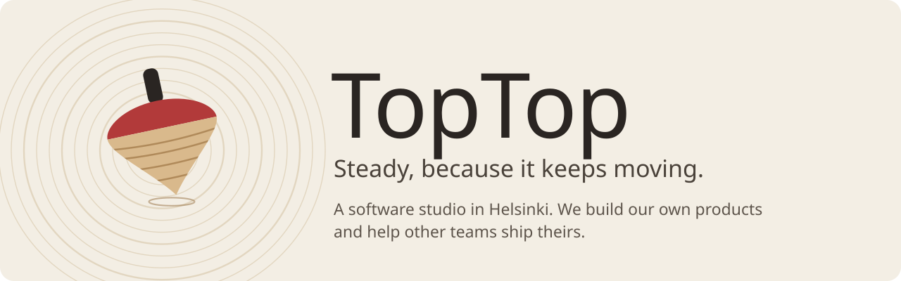
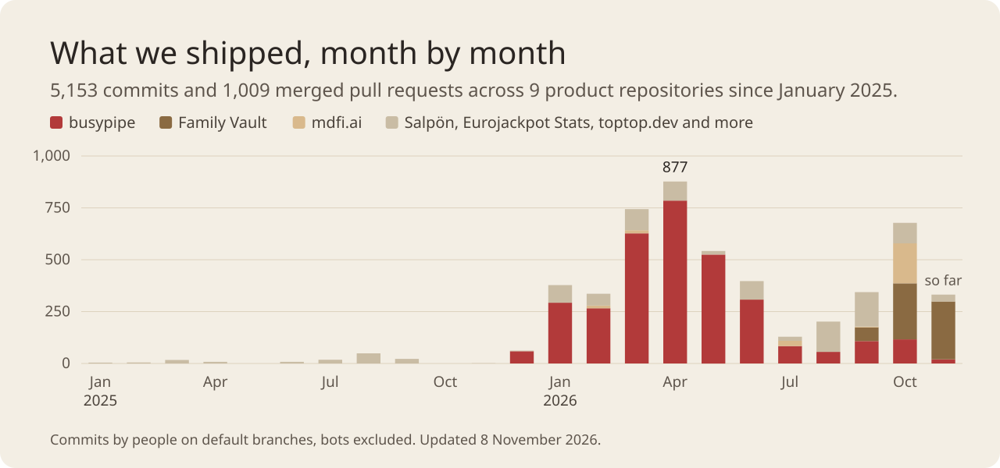

<a href="https://toptop.dev">
  <picture>
    <source media="(prefers-color-scheme: dark)" srcset="assets/banner-dark.svg">
    
  </picture>
</a>

 

Most of what we build is our own: products we run, pay for and support ourselves. The rest of the time we help other teams get their software into production.

## Our products

| Product | What it does | Status |
|---|---|---|
| **[busypipe](https://busypipe.com)** | TikTok intelligence for agencies and brands. Track the accounts that aren't yours: competitors, creators and whole categories, organised into portfolios your team shares. AI agents can query it over MCP. | Live since April 2026 |
| **[mdfi.ai](https://mdfi.ai)** | Turns PDFs, scans, Office files, web pages and audio into clean markdown for LLMs. Each page gets a quality score, and pages that read badly are re-read by OCR or a vision model. | Cloud API coming soon |
| **Family Vault** | A mobile vault where older people keep what their family would need: money, insurance, papers and wishes. End-to-end encrypted, with a family handover that opens only after a waiting period the owner controls. | In development |
| **[Salpön](https://salpon.com)** | Kids' party invitations behind one link: invitation cards, RSVPs, a gift registry, messages and a shared photo album. | Live |
| **[Eurojackpot Stats](https://eurojackpotstats.eu)** | Eurojackpot statistics with an honest side: how unique your numbers are, and what playing them would really have returned. | Live |

## How we work

<picture>
  <source media="(prefers-color-scheme: dark)" srcset="assets/activity-dark.svg">
  
</picture>

We ship in small pull requests, test what matters and measure before we claim anything:

- **busypipe** has tracked more than 166,000 TikTok profiles, hashtags and sounds since launch day. It runs on an event pipeline (Redpanda, S3, TimescaleDB) and has 699 merged pull requests behind it.
- **Family Vault** has more than 1,700 automated tests. Its encryption core was checked with mutation testing, and every one of the 83 deliberately planted bugs was caught.
- **mdfi.ai** output costs Claude 1.7 to 2.8 times fewer input tokens than the original PDF, with the same answers to every test question.
- **[toptop.dev](https://toptop.dev)** is available in six languages and loads its main content in 0.7 seconds.

## Work with us

- **Software development.** We design, build and run web, mobile and data products, from the first architecture sketch to production.
- **[Ship It](https://toptop.dev/ship-it).** You built an app with AI and it's stuck before launch. We review it for production, then ship it with you or for you.
- **[Architect Track](https://toptop.dev/architect-track).** One-to-one mentoring for engineers who are moving into software architecture.
- **[Communication Coaching](https://toptop.dev/communication-coaching).** One-to-one coaching for engineers who want to be heard in meetings, reviews and interviews.

Have a project in mind? [Get in touch](https://toptop.dev/contact).

 

TopTop Oy, Helsinki, Finland. The charts on this page are generated from our repositories by <a href="https://github.com/TopTop-Oy/.github/blob/main/scripts/build_assets.py"><code>scripts/build_assets.py</code></a>.
